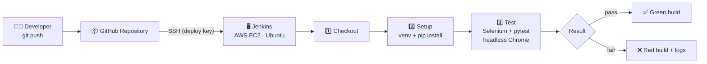
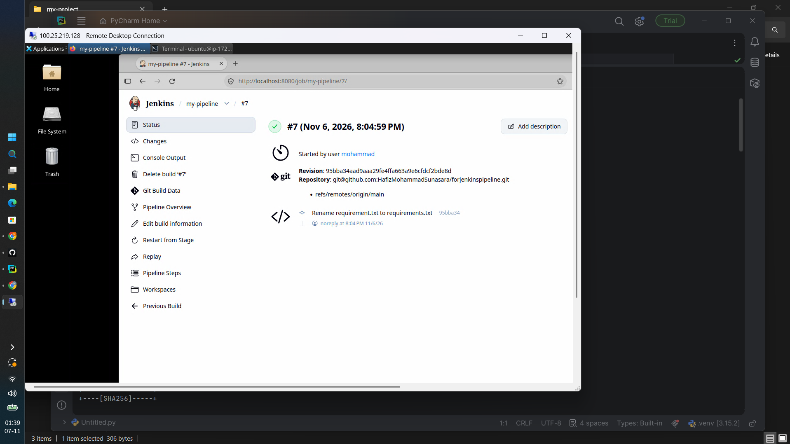
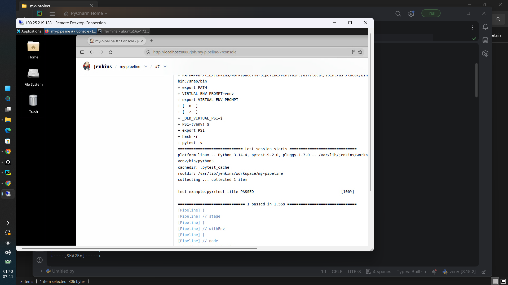

<div align="center">

# ⚙️ CI Pipeline with Jenkins, AWS EC2 & Selenium

### Push code. Jenkins pulls it, builds it, and tests it in a real browser, automatically.


</div>

---

## 🚀 Overview

This project is an **end-to-end Continuous Integration (CI) pipeline** running on a **Jenkins server hosted on AWS EC2 (Ubuntu)**.

Jenkins securely pulls the code from this GitHub repository over **SSH**, creates an isolated **Python virtual environment**, installs dependencies, and runs **automated Selenium browser tests** with **pytest** in **headless Google Chrome**. The result is a clear pass/fail signal on every build, with zero manual testing.

> **Why it matters:** catching broken code early, automatically and repeatably, is the foundation of modern DevOps and QA automation.

---

## 🧭 Architecture



---

## 🔄 Pipeline Stages

Defined as code in the [`Jenkinsfile`](./Jenkinsfile) (Declarative Pipeline):

| Stage | What happens |
|-------|--------------|
| **1. Checkout** | Jenkins clones the latest code from GitHub using an SSH credential. |
| **2. Setup** | Creates a Python `venv` and installs `selenium` and `pytest` from `requirements.txt`. |
| **3. Test** | Runs `pytest -v`. Selenium launches headless Chrome, opens a page and asserts on its title. |

If any stage fails, the following stages are skipped and the build is marked **failed**, with full logs in the Jenkins console.

---

## 🛠️ Tech Stack

| Area | Tools |
|------|-------|
| **Cloud** | AWS EC2 (Ubuntu) |
| **CI Server** | Jenkins (Pipeline as Code) |
| **Source Control** | Git, GitHub (SSH authentication) |
| **Language** | Python 3 |
| **Testing** | Selenium WebDriver, pytest |
| **Browser** | Google Chrome (headless) |

---

## 📁 Project Structure

```
forjenkinspipeline/
├── Jenkinsfile          # Pipeline definition (Checkout → Setup → Test)
├── requirements.txt     # Python dependencies (selenium, pytest)
├── test_example.py      # Selenium test (headless Chrome)
├── screenshots/         # Build and console screenshots
└── README.md
```

---

## 📸 Screenshots

### ✅ Successful Jenkins build



### 🧾 Console output (tests passed)



---

## ⚡ Run It Yourself

**Prerequisites:** an Ubuntu server (e.g. AWS EC2) with Jenkins running, Git, and a GitHub account.

**1. Install dependencies on the server**

```bash
sudo apt update && sudo apt install -y python3-venv python3-pip
wget https://dl.google.com/linux/direct/google-chrome-stable_current_amd64.deb
sudo apt install -y ./google-chrome-stable_current_amd64.deb
```

**2. Create an SSH key for Jenkins**

```bash
ssh-keygen -t ed25519 -f ~/jenkins_key -N ""
cat ~/jenkins_key.pub      # add this PUBLIC key to GitHub -> Settings -> SSH keys
```

**3. Add the private key to Jenkins**

`Manage Jenkins → Credentials → Add Credentials`
Kind: *SSH Username with private key* · ID: `github-ssh` · Username: `git`

**4. Create the pipeline job**

`New Item → Pipeline → Pipeline script from SCM`
SCM: Git · URL: `git@github.com:HafizMohammadSunasara/forjenkinspipeline.git` · Credentials: `github-ssh` · Branch: `*/main` · Script Path: `Jenkinsfile`

**5. Click Build Now** and watch the stages run. 🎉

---

## 🧩 Challenges I Solved

Real pipelines fail, and debugging them is where the learning happens.

- **SSH authentication:** understood why the *public* key belongs on GitHub and the *private* key in Jenkins, and used a dedicated key pair for the Jenkins server.
- **"Repository not found":** traced it to a wrong repository URL by reading the Jenkins console logs.
- **Dependency failure:** the pipeline failed with *Could not open requirements file*. The cause was a filename typo (`requirement.txt` vs `requirements.txt`), found by reading the logs bottom-up.
- **Headless browser on a server:** configured Chrome with `--headless`, `--no-sandbox` and `--disable-dev-shm-usage` so tests run on a machine with no display.

---

## 🔐 Security Practices

- Separate SSH keys for the laptop and the Jenkins server
- Private key stored only in **Jenkins Credentials**, never in code or the repo
- Removed an outdated Jenkins plugin that carried a security warning

---

## 🗺️ Roadmap

- [ ] GitHub webhook for automatic builds on every `git push`
- [ ] JUnit / HTML test reports inside Jenkins
- [ ] Build failure notifications (email / Slack)
- [ ] Docker-based test environment
- [ ] Parallel cross-browser testing with Selenium Grid
- [ ] Deploy stage (CD) after successful tests

---

## 📚 What I Learned

CI/CD fundamentals · Pipeline as Code · Jenkins administration · Linux server setup on AWS · SSH key authentication · Selenium test automation · Reading logs to debug failures

---

## 👨‍💻 Author

**Hafiz Mohammad Sunasara**

[](https://github.com/HafizMohammadSunasara)
[](https://www.linkedin.com/in/YOUR-LINKEDIN-USERNAME)

<div align="center">

⭐ If you found this useful, consider giving the repo a star!

</div>
